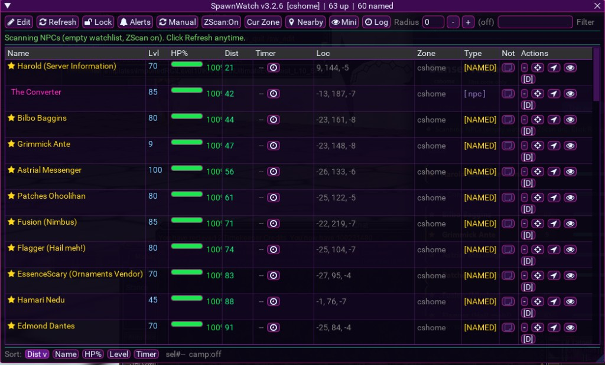
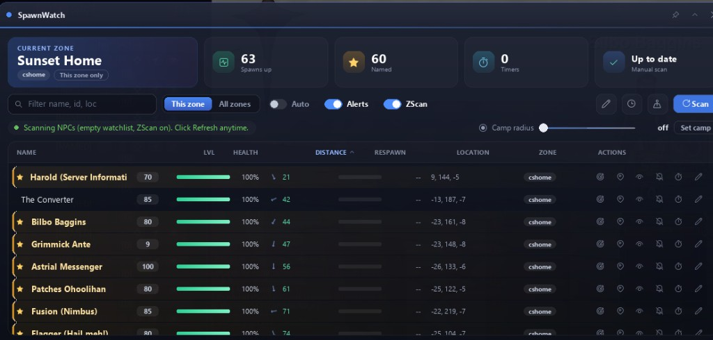

# MQ2RmlUi GUI systems (RedGuides / MQ emu)

Modern HTML/CSS-style UI chrome for MacroQuest emu builds via **MQ2RmlUi**, with SpawnWatch and related tools ported off ImGui for a sharper in-game look.

## Screenshots

### SpawnWatch — classic ImGui

### SpawnWatch — RmlUi

## Included

| Path | Purpose |
|------|---------|
| `plugins/MQ2RmlUi.dll` | RmlUi host plugin (DX9 / RoF2 emu) |
| `lua/rmlui/` | Lua binding + shared window theme |
| `lua/spawnrml/` | SpawnWatch RmlUi main window |
| `lua/rmlhud/` + `lua/teghud.lua` | Vitals / combat HUD |
| `lua/godtier*` + `lua/godtier/` | God Tier 71–75 + talents |
| `lua/gmconsole/init.lua` + `ui/` | GM console chrome |
| `lua/ueqtool.lua` + `lua/ueqtool/ui/` | Ultimate EQ launcher (Rml) |
| `lua/UltimateEQ/` | Quest / hunter HUD (Rml) |
| `lua/ProEQ/init.lua` | Thin redirect → UltimateEQ |
| `lua/rmlclose.lua` | Force-close orphan Rml windows |

## Not included

Lua package caches (`modules/…/luarocks`), demos (`rmluidemo`), personal configs, logs, and unrelated ImGui tools.

## Quick start

1. Ensure `plugins/MQ2RmlUi.dll` is loaded (`/plugin MQ2RmlUi`).
2. `/lua run ueqtool` — launcher  
3. `/lua run spawnrml` — SpawnWatch RmlUi (ImGui original remains `/lua run spawn`)  
4. `/lua run UltimateEQ` · `/lua run godtier` · `/lua run teghud` · `/lua run gmconsole`

Windows close immediately on `/lua stop` via script cleanup + ownership GC (plugin autoclose is backup only).
